# 🚀 Hyper V Ubuntu Server & Docker Web Hosting Lab
A comprehensive, highly detailed technical log documenting the end-to-end process of setting up a local virtualization environment on Windows using Hyper-V, provisioning an Ubuntu Server LTS virtual machine, bridging network adapters, and deploying a containerized web server via Docker and Docker Compose.

## 🛠️ Infrastructure and Tech Stack
* **Host OS:** Windows 11 Pro
* **Hypervisor:** Windows Hyper-V
* **Guest OS:** Ubuntu Server 26.04.1 LTS
* **Networking:** External Virtual Switch bridged to the Realtek PCIe GbE Family Controller
* **Containerization:** Docker Engine and Docker Compose Plugin
* **Web Stack:** Nginx with custom HTML/CSS

## 📋 Execution Log
### Step 1: Hyper-V Feature Activation and External Network Bridging
1. **Enable Hyper-V:**
     * Opened Window's start menu and searched for ***Turn Windows features on or off***.
     * Selected ***Hyper-V*** and ensured ***Hyper-V Management Tools*** and the ***Hyper-V Platform*** are fully enabled.
     * Rebooted system to initialize the hypervisor.

    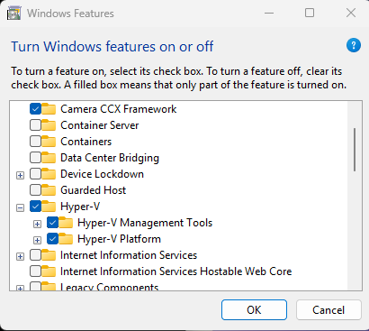

2. **Configure the External Virtual Switch:**
    * Launched ***Hyper-V Manager*** and connected to the local host.
    * Opened ***Virtual Switch Manager*** and created a new virtual switch named "HomeLab-Switch".
    * Bound the switch directly to the physical network adapter, ensuring that ***Allow management operating system to share this network adapter*** is selected to allow the VM to pull an independent IP address directly from home router's DHCP pool.

    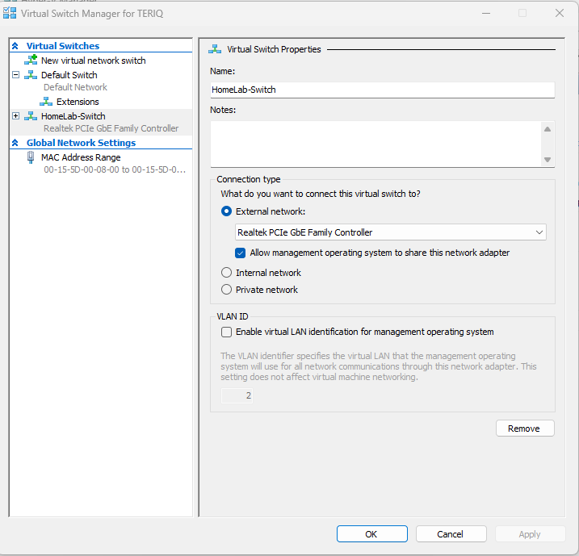

### Step 2: Virtual Machine Preparation
1. **Wizard Configuration:**
    * Clicked **New > Virtual Machine** to launch the creation wizard.
    * **Name and Location:** Named the VM "Ubuntu-Web-Server" and stored it in the default Hyper-V path.
    * **Specify Generation:** Selected **Generation 2** to gain UEFI-based firmware support, secure boot options, and modern virtual hardware acceleration.
    * **Assign Memory:** Allocated **4096 MB (4 GB)** memory and left *Dynamic Memory* disabled to guarantee steady performance.
    * **Configure Networking:** Connected the VM's virtual network adapter to "HomeLab-Switch".
    * **Connect Virtual Hard Disk:** Created VHDX file called "Ubuntu-Web-Server.vhdx" with a capacity of **30 GB**
    * **Installation Options:** Selected **Install an operating system from a bootable image file (.iso)** and selected the appropriate, previously downloaded **Ubuntu Server .iso** file.

    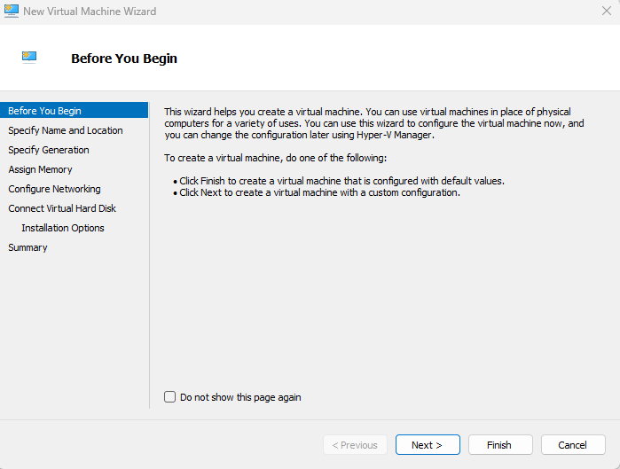

**Note:** Before booting, accessed the VM's **Settings > Security** menu to uncheck **Enable Secure Boot** to prevent Linux bootloader from being restricted during deployment.

### Step 3: Ubuntu Server Installation and OpenSSH Setup
1. **OS Installation:**
    * Connected to and powered on VM console.
    * Selected **Try or Install Ubuntu Server** from GRUB boot menu.
    * Walked through installer and accepted standard settings.

  

    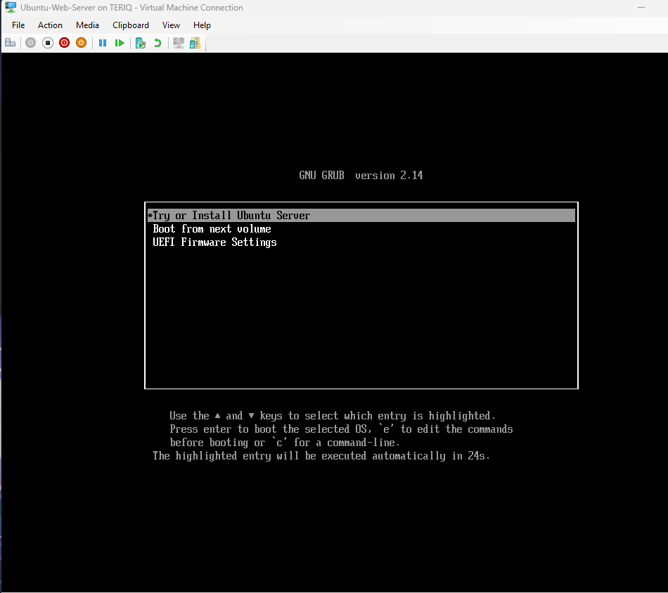

      
2. **Network and Profile Configuration:**
    * Verified that the installer's network configuration detected the "HomeLab-Switch" interface and successfully leased a local IP with DCHP.
    * Configured user profile details (name, server host name, username).
3. **Enable Remote SSH Access:**
    * Selected **Install OpenSSH server** and **Allow Password authentication over SSH**.
    * Allowed installer to complete necessary actions and rebooted system.
  

    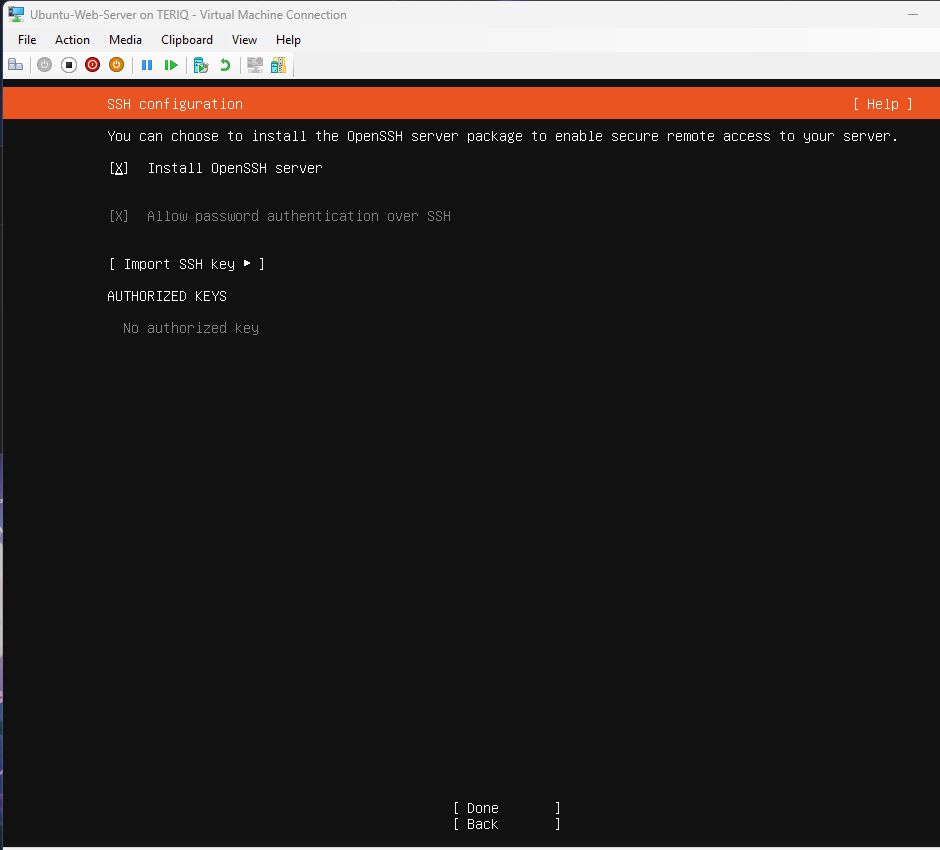

  
### Step 4: Host-to-Guest SSH and Docker Environment Setup
1. **Establish SSH Tunnel**
    * Verified VM's local IP using *ip a* in the terminal.
    * Opened **Powershell** on host machine and remotely connected to server.
  

    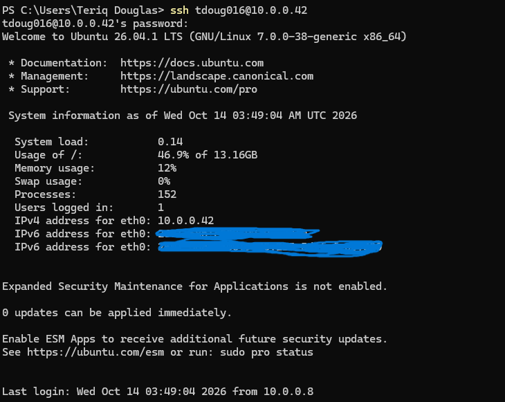

      
2. **Install Docker Engine and Compose**
    * Updated system packages and tools.
    * Added Docker's official signing keys and repository configuration.
    * Added user  to the docker group to enable container execution without root privileges.

    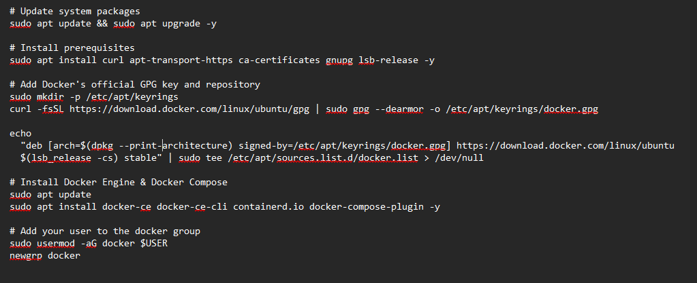

### Step 5: Containerized Web Server Deployment
1. **Directory Structure and Assets**
    * Created project workspace.
    * Developed custom HTML/CSS landing page.
  

    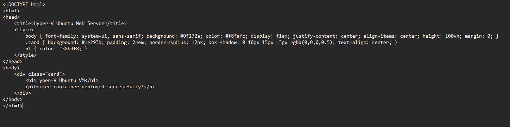

2. **Docker Compose:**
    * Created docker compose *.yml* file specifying an Alpine-based Nginx container, port binding from host port '80' to container port '80', and a read-only bind mount for local HTML directory.
  

    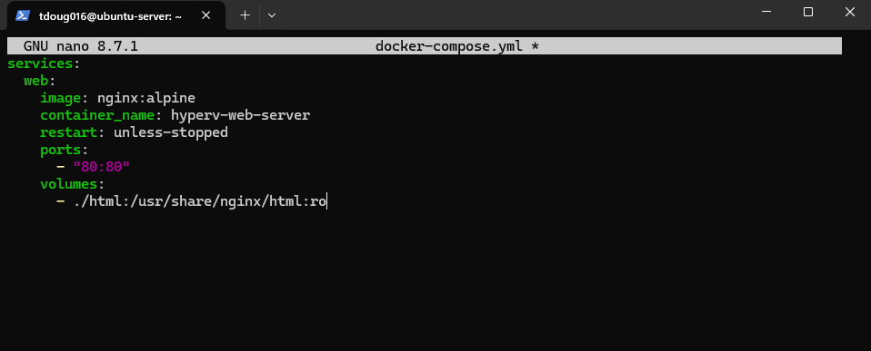

   
4. **Launching Stack:**
    * Executed container deployment
    * Verified container health and interfaced
  

    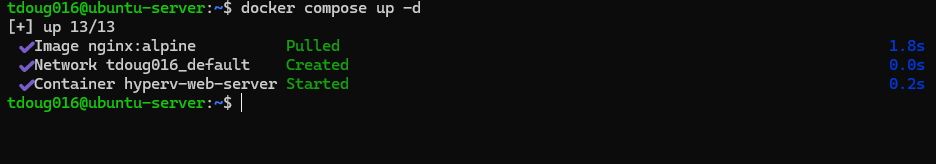

  
## 📸 Validation and Verification
* **Local Network Validation:** Opened Windows host web browser and navigated to host IP.
* **Result:** Successfully loaded custom webpage, validating hosting.

    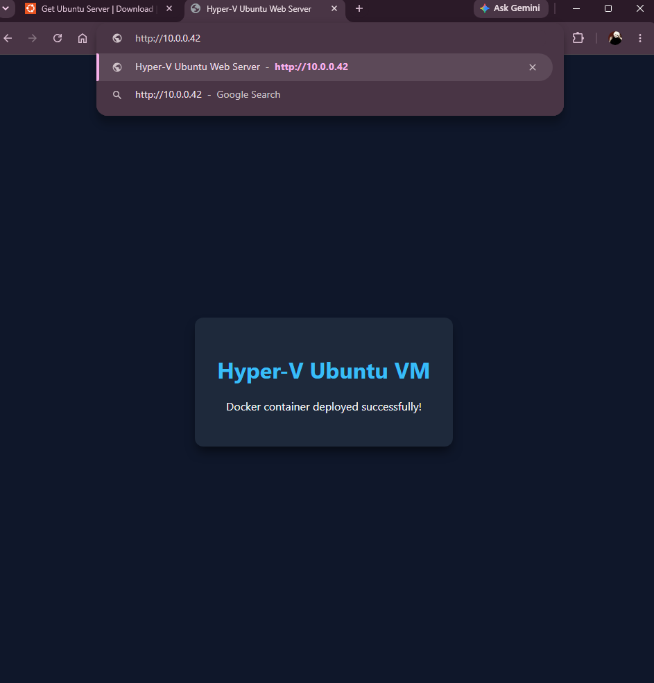

